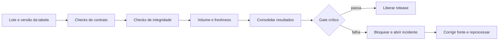

# 02 — Qualidade e observabilidade de dados

**Estado demonstrado:** MVP validado. Evidências de 28/10/2026 quando aplicável.

Este documento preserva requisitos e design do estudo. Etapas futuras, quantidades planejadas e critérios de aceite não comprovam execução. Consulte o estudo de caso para escopo, resultados e limites atuais.

**Estado do plano original:** planejado. **Competência:** projetar um pipeline que detecta erro, explica impacto e recupera a operação. **Dependência:** tabelas e contrato do projeto 01; pode começar com uma pequena fixture sintética independente. Padrões comuns no planejamento geral.

## Requisitos e escopo

| ID | Requisito | Aceite futuro |
| --- | --- | --- |
| RF01 | Catálogo de regras versionado por tabela | Regra tem ID, severidade, expressão, limiar e responsável fictício |
| RF02 | Checks de schema, linha e conjunto | Regras executadas na granularidade apropriada |
| RF03 | Bloquear publicação diante de erro crítico | Gold aprovada anterior permanece disponível |
| RF04 | Detectar volume/freshness anormais | Resultado inclui referência, observado e diferença |
| RF05 | Manter histórico e permitir investigação | Checks ligados a execution_id, tabela e versão Delta |
| RF06 | Ensaiar recuperação | Falha injetada e resolução registradas com evidências |
| RNF01 | Separar regras de implementação | Configuração de regra legível e versionada |
| RNF02 | Evitar coleta excessiva | Amostras apenas sintéticas e limitadas nos logs |

Primeira versão: checks explícitos Spark/SQL e tabelas de monitoramento. Great Expectations/Soda e monitor gerenciado ficam como comparação futura, sem três motores diferentes no MVP.

## Dados e contratos de saída

Entradas: lotes sintéticos do projeto 01 e um catálogo de falhas conhecidas. Construir 20 cenários: 10 cargas válidas e 10 com falha/alerta, incluindo duplicação, chave ausente, referência inválida, devolução impossível, quebra de tipo, atraso, pico e queda de volume. Guardar o resultado esperado por cenário.

`workspace.estudos_ops.aurora_regras`: `rule_id`, `rule_version`, `dataset`, `severity`, `expression`, `threshold`, `enabled`.

`aurora_checks`: `execution_id`, `dataset_version`, `table_version`, `rule_id`, `observed`, `threshold`, `status`, `failed_rows`, `checked_at`, `evidence_path`.

`aurora_incidentes`: `incident_id`, `execution_id`, `severity`, `status`, `opened_at`, `resolved_at`, `recovery_execution_id`. `status` de check: pass, fail, error ou not_applicable. Erro do próprio check não equivale a aprovação.

## Design e DAG

As regras retornam resultados estruturados; a política de severidade decide a liberação. Não permitir que um texto gerado por LLM aprove uma carga. O check de existência de artefato crítico é feito antes de qualquer escrita de publicação.

Regras críticas iniciais: schema incompatível, event_id nulo/conflitante e diferença de reconciliação. Regras de alerta: atraso/volume fora da faixa. Para volume, uma proposta inicial é desvio de 30% da mediana dos últimos 7 lotes comparáveis; com menos de 7 lotes marcar referência insuficiente. Esse limiar será avaliado com os cenários, não tratado como verdade universal.

Freshness: medir `checked_at - max(event_time)` e atraso `ingested_at - event_time` separadamente. Um lote histórico/backfill não deve disparar o mesmo alerta de uma carga diária atual; o modo de carga faz parte do contrato.

## Bibliotecas e componentes

| Tecnologia | Função |
| --- | --- |
| PySpark e SQL | Regras distribuídas, agregações e integridade referencial |
| Delta | Tabelas de checks, incidentes e versões de dados |
| `pydantic` | Validar estrutura das configurações de regras |
| `pytest` | Verificação futura de cenários e políticas puras |
| MLflow | Comparar políticas de limiar com o mesmo conjunto rotulado |
| Lakeflow Jobs + painel SQL | Gate, reparo e visibilidade das falhas |

Expectations de `pyspark.pipelines` são uma extensão opcional ao evoluir o projeto 01. Configuração de regras não pode virar execução irrestrita de código arbitrário; restringir tipos/expressões e revisar o catálogo.

## Experimentos, MLflow e métricas

Experimento proposto: `.../02_qualidade_observabilidade/experimentos/deteccao_falhas`.

| ID | Hipótese e comparação | Medidas |
| --- | --- | --- |
| Q01 | Limiar fixo × referência de lotes comparáveis | precisão/recall de alerta e falsos positivos |
| Q02 | Falhas isoladas × falhas combinadas | taxa de falha crítica detectada e diagnóstico |
| Q03 | Pipeline íntegro × falha no próprio check | nenhuma liberação por ausência de avaliação |

Runs guardam versão de regras, cenário, severidade e parâmetros. Artefatos: matriz cenário × regra, motivos de falso positivo/negativo e runbook. Dados de incidente continuam em Delta; MLflow registra a comparação experimental, sem Model Registry.

Metas propostas: detectar todos os casos críticos conhecidos e obter zero liberações indevidas nesse conjunto. Reportar separadamente cenários não cobertos. Tempo de detecção e recuperação só serão informados quando medidos. Máximo inicial de 3 políticas de limiar × 20 cenários.

## Plano de validação e operação

- Validar regra inválida, dataset ausente e coluna removida: resultado error e gate fechado.
- Confirmar que um alerta não crítico não impede uma liberação válida, mas aparece na evidência.
- Reexecutar o mesmo check com chave `execution_id + rule_id + rule_version` sem duplicação.
- Corrigir um lote e ligar a resolução do incidente à nova execução, preservando o histórico anterior.
- Não calcular taxa de alertas dividindo por um denominador que exclui os checks que falharam ao executar.

Roteiro: contrato de regras → checks críticos → cenários rotulados → observabilidade → gate no projeto 01 → ensaio de falha e recuperação. Entregas: catálogo, resultados, painel de qualidade, runbook de pelo menos três incidentes e relatório de avaliação.

**Demonstração:** um Job termina tecnicamente, mas o gate detecta que a origem perdeu registros; a publicação fica bloqueada, o incidente é explicado e o reprocessamento correto libera a próxima versão. Essa narrativa demonstra confiabilidade além de um notebook que apenas roda.

Riscos: limiar mal calibrado, referência insuficiente e falha de monitoramento. As políticas devem ter estados explícitos e nunca presumir normalidade quando não há evidência.

Referências: [Lakeflow Jobs](https://docs.databricks.com/aws/en/jobs/), [pipelines e expectations](https://docs.databricks.com/aws/en/ldp/developer/python-ref) e [MLflow Tracking](https://mlflow.org/docs/latest/ml/tracking/).
